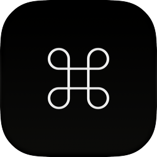
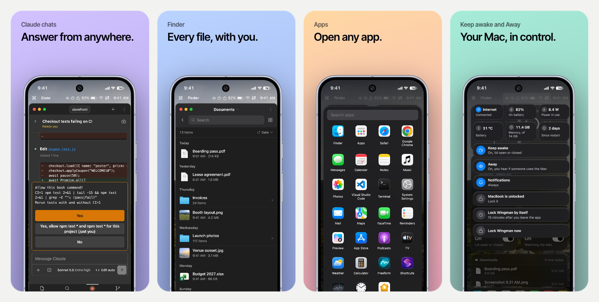

<div align="center">

<picture>
  <source media="(prefers-color-scheme: dark)" srcset="assets/icon-for-dark.png">
  
</picture>

# Wingman

**Your Mac, in your pocket.**<br>
Answer Claude, open any app and find any file on your Mac, from your Android phone.

<br>

[](https://github.com/rohan-phogat/wing/releases/latest/download/Wingman.zip)&nbsp;&nbsp;[](https://getwingman.tech/download/android)

[](https://github.com/rohan-phogat/wing/releases/latest) [](https://github.com/rohan-phogat/wing/releases)   [](https://getwingman.tech)

[Website](https://getwingman.tech) &nbsp;·&nbsp; [Features](https://getwingman.tech/features) &nbsp;·&nbsp; [FAQ](https://getwingman.tech/faq) &nbsp;·&nbsp; [What's new](https://getwingman.tech/updates) &nbsp;·&nbsp; [Privacy](https://getwingman.tech/privacy)

</div>

<br>

<p align="center">
  
</p>

## What is Wingman?

Wingman puts your Mac on your Android phone. Install it on your Mac once, scan a code with your phone, and from then on you can answer your Claude chats, work in VS Code, open any app, find any file and keep your Mac awake, wherever you are. Your phone and your Mac do not need to be on the same Wi-Fi, and everything between them is sealed end to end.

## What you can do

**Claude and your code**

- **Claude chats.** See every Claude chat running in VS Code on your Mac. Read what Claude did, answer its questions, say yes or no when it asks to run a command, and reply.
- **Pop-up windows and cards.** Open any Claude or Copilot chat in a window of its own on your Mac, on every desktop. When a chat finishes, a card appears in the corner: read the answer and reply right there.
- **VS Code, on your phone.** Browse the project, open and edit files, search it, run commands in its terminal, ask Copilot, and look through and commit your changes. It is your real VS Code window.
- **Copilot and the terminal.** Ask the GitHub Copilot that is already signed in to VS Code on your Mac, or run commands in VS Code's terminal and your Mac's Terminal windows.

**Your Mac**

- **Finder.** Browse your Desktop, Documents and Downloads, search by name and open a file to see it.
- **Chrome.** Your Mac's own Chrome, with your open tabs and your logins.
- **Apps.** Every app on your Mac is in a launcher on your phone. The ones that are running have a dot beside their name.
- **Control centre and home widgets.** Its connection, battery, memory and temperature at a glance, and a home screen you arrange from your Mac.

**In control**

- **Keep awake.** One switch keeps your Mac awake, lid open or closed, so a long job keeps running.
- **Away.** Turn it on and your phone warns you if someone unlocks your Mac, with a button to lock it again.
- **Locks itself.** Wingman locks when you leave the app and opens with your PIN.
- **Updates itself.** The Mac app keeps itself up to date, and your phone tells you when a newer Android app is ready.

See all of it, with pictures, on the [Features page](https://getwingman.tech/features).

## Get started

| | You need |
|---|---|
| **Mac** | Apple silicon (M1 or newer), macOS 13 or later |
| **Phone** | Android 6 or later |
| **Both** | An internet connection. VS Code and Claude Code only for the parts that use them: Finder, Chrome, your apps, Keep awake and Away work without either. |

1. **Download the Mac app.** Get [**Wingman.zip**](https://github.com/rohan-phogat/wing/releases/latest/download/Wingman.zip), open it, and move Wingman to your Applications folder.
2. **Open it** (see the note below the first time). Wingman lives in your menu bar.
3. **Set it up.** Choose a PIN (six to twelve digits) and say what Wingman may use on your Mac. It then shows a code.
4. **Pair your phone.** Your Mac hands the Android app to your phone when you set it up, or you can [download the Android app](https://getwingman.tech/download/android) directly (Android asks you to allow installs from your browser the first time). Open Wingman on your phone and scan the code, then approve the new phone on your Mac. You are connected.

> [!IMPORTANT]
> **macOS blocks Wingman the first time you open it.** Wingman is not notarized by Apple yet, so macOS says it cannot verify the app. That is expected, and you only do this once:
>
> 1. Try to open Wingman, then click **Done**.
> 2. Open **System Settings → Privacy & Security** and scroll down to the **Security** section.
> 3. Next to “Wingman was blocked”, click **Open Anyway**, enter your password, then click **Open**.

<details>
<summary>Prefer Terminal?</summary>

<br>

If you would rather not use System Settings, this removes the download flag from the app (adjust the path if you put Wingman somewhere else), and macOS opens it normally:

```sh
xattr -dr com.apple.quarantine /Applications/Wingman.app
```

</details>

## Privacy and security

- **No tracking.** No analytics, no ads, no accounts and no cookies, in the apps and on the website.
- **Sealed end to end.** Everything between your phone and your Mac is encrypted with keys that only the two of them hold. Wingman's server passes sealed bytes along and cannot read them.
- **You approve every phone.** The pairing code works once and expires after two minutes, each new phone has to be approved on your Mac, and the app is protected by your PIN. Remove a phone from your Mac at any time and it stops working straight away.
- **A few connection details.** A random ID for your Mac, its name, the versions you run and usage counts such as minutes online. Nothing else. The [Privacy page](https://getwingman.tech/privacy) lists all of it.

## FAQ

<details>
<summary><b>Does it cost anything?</b></summary>

<br>

Wingman is free. Claude Code and GitHub Copilot work through your own accounts for them, so they need whatever those accounts need.

</details>

<details>
<summary><b>Is there an iPhone app?</b></summary>

<br>

No. Wingman is for Android phones.

</details>

<details>
<summary><b>Does it work when I am away from home?</b></summary>

<br>

Yes. Your phone and your Mac each connect out to Wingman's relay, so they do not need to be on the same Wi-Fi. Your Mac has to be on, awake and online.

</details>

<details>
<summary><b>What if my Mac goes to sleep?</b></summary>

<br>

Your phone shows it as offline until it wakes. Turn on **Keep awake** before you leave a long job running: it keeps your Mac awake, lid open or closed.

</details>

<details>
<summary><b>How many phones can I use?</b></summary>

<br>

Up to eight phones can be connected to the same Mac at once.

</details>

<details>
<summary><b>My phone says my Mac is offline.</b></summary>

<br>

Check that your Mac is awake, online and running Wingman. If it was asleep, wake it and turn on Keep awake. If it is on an old version of Wingman, update it from the Mac app.

</details>

More answers are on the [FAQ page](https://getwingman.tech/faq).

## Updates

The Mac app checks for a new version and updates itself. When a newer Android app is ready, Wingman tells you and Android asks you to confirm. What changed in every version is in [Releases](https://github.com/rohan-phogat/wing/releases) and on the [Updates page](https://getwingman.tech/updates).

## Report a bug or ask for a feature

- **From the app.** In the Mac app press **Report a bug** in the sidebar, or open **Settings** on your phone. You can add screenshots or a recording, and it goes straight to the people who build Wingman.
- **Here on GitHub.** [Report a bug](https://github.com/rohan-phogat/wing/issues/new?template=bug_report.yml) or [ask for a feature](https://github.com/rohan-phogat/wing/issues/new?template=feature_request.yml).
- **A security problem.** Please do not open a public issue. See [SECURITY.md](SECURITY.md).

Please do not put passwords or anything private in a report or a screenshot.

## About this repository

This repository holds Wingman's downloads ([Releases](https://github.com/rohan-phogat/wing/releases)) and its public issue tracker. Wingman's source code is not published here.

## Trademarks

Wingman is an independent app. It is not made, endorsed or sponsored by Apple, Google, Microsoft, GitHub or Anthropic. Mac and macOS are trademarks of Apple Inc., Android is a trademark of Google LLC, Visual Studio Code is a trademark of Microsoft Corporation, GitHub Copilot is a trademark of GitHub, Inc., and Claude is a trademark of Anthropic, PBC.

<br>

<div align="center">

© 2026 Wingman &nbsp;·&nbsp; [getwingman.tech](https://getwingman.tech)

</div>
